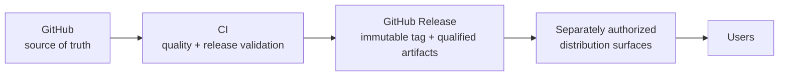

# Releases — Publication & Artifact Lifecycle

- **Status:** Binding strategy governed by
  [ADR-0010](../adr/0010-release-architecture.md) and
  [ADR-0011](../adr/0011-versioning-licensing.md), both **Accepted**
- **Original design date:** 2026-07-10
- **Governance reconciliation:** 2026-09-03

This section defines how every MedScale artifact is versioned, licensed, validated,
released, distributed, deprecated, and — if ever necessary — retracted. It exists so
that publication is a *governed pipeline*, not an event.

## The canonical flow (never the reverse)

- **GitHub is the only source of truth.** Every published artifact traces to governed
  repository identity and the applicable release/tag evidence.
- **External surfaces are distribution only.** Nothing originates there; a mirror or
  package index entry that drifts from its source release is a defect.
- **CI is the only publisher.** Manual external uploads are prohibited; each external
  distribution path must have its own qualified CI automation and operator gate
  ([ci_cd.md](ci_cd.md)).
- **Current implementation is partial and fail-closed.** `.github/workflows/release.yml`
  implements package build/GitHub Release automation, exact-artifact qualification, and
  an ALIGN-24 TestPyPI Trusted Publishing job. The TestPyPI edge remains disabled unless
  `TESTPYPI_PUBLISH_ENABLED == 'true'`; repository code does not prove that the required
  protected Environment or matching TestPyPI Trusted Publisher exists. Production PyPI
  and Hugging Face publication remain separately gated and unimplemented.

## Principles

1. **Released = immutable.** A version, once published, never changes; fixes are new
   versions ([versioning.md](versioning.md)).
2. **No artifact without the applicable reproducibility record.** Release evidence is
   governed by [reproducibility.md](reproducibility.md) and the artifact-specific gate.
3. **No artifact without a gate.** Each class has release criteria and a checklist
   ([release_process.md](release_process.md)); an artifact that fails its gate does not
   ship, whatever the calendar says.
4. **Licence before bytes** (Rule R3): licence review precedes publication, per field
   where required ([licensing.md](licensing.md)).
5. **Retraction is visible, not silent** — artifacts are marked and superseded, never
   silently deleted.

## Documents

| Document | Covers |
|---|---|
| [software_release_track.md](software_release_track.md) | Founder-prioritized synthetic-only package/developer-preview track, with independent scientific/clinical boundaries and evidence gates |
| [developer_beta_publication_handoff_20261024.md](developer_beta_publication_handoff_20261024.md) | Exact-source offline dual-Python publication rehearsal, qualified artifact SHA, and outstanding requirements before any later publishing decision |
| [prepublication_qualification_20261023.md](prepublication_qualification_20261023.md) | Read-only exact-wheel metadata audit, synthetic Windows installation evidence, and explicit no-go conditions before a future release |
| [isolated_core_projection_20261023.md](isolated_core_projection_20261023.md) | Proposed source-attested isolated Core packaging lane that preserves frozen MRL inputs and cannot publish |
| [core_release_decision_preflight_20261023.md](core_release_decision_preflight_20261023.md) | Unapproved architecture alternatives, exact-head evidence matrix, historical compatibility limits, and explicit review-versus-publication gates |
| [tag_ruleset_handoff_20261024.md](tag_ruleset_handoff_20261024.md) | Administrator-only release-tag protection checklist and read-only GitHub ruleset admission; no tag or publication authorization |
| [successor_version_decision_574.md](successor_version_decision_574.md) | Proposed next software version, frozen-input reconciliation options, compatibility and release-authority gates — not a release approval |
| [historical_compatibility_preflight_574.md](historical_compatibility_preflight_574.md) | Exact-tag-to-main public API, CLI and dataset-integrity preflight; behavioral and persisted-format gates still open |
| [historical_dataset_compatibility_replay_20261024.md](historical_dataset_compatibility_replay_20261024.md) | Reproducible pinned v0.2.0-versus-candidate synthetic dataset differential, SHA-256 evidence and immutable-writer guard receipts |
| [v0_3_0_candidate_qualification.md](v0_3_0_candidate_qualification.md) | Versioned Core developer preview candidate, exact identity tests, safety bounds and publication gates — not a release |
| [v0_3_0_compatibility_disposition_574.md](v0_3_0_compatibility_disposition_574.md) | Bounded no-rewrite/no-auto-migration policy and frozen package-metadata isolation for source candidate, with remaining publication gates |
| [artifact_lifecycle.md](artifact_lifecycle.md) | Every artifact class, its states and gates |
| [versioning.md](versioning.md) | Binding version schemes for package, models, datasets, benchmarks, schemas, docs, ADRs |
| [release_process.md](release_process.md) | The release procedure + all checklists (incl. deprecation, retraction) |
| [distribution.md](distribution.md) | GitHub Releases + separately governed distribution surfaces |
| [licensing.md](licensing.md) | Binding per-artifact licensing matrix, inheritance, citation requirements |
| [model_cards.md](model_cards.md) | Required model-card content |
| [dataset_cards.md](dataset_cards.md) | Required dataset-card content |
| [benchmark_publication.md](benchmark_publication.md) | Benchmark spec, immutability, leaderboard policy |
| [papers.md](papers.md) | Research → paper → replication-package workflow |
| [reproducibility.md](reproducibility.md) | Release reproducibility/evidence requirements |
| [ci_cd.md](ci_cd.md) | Current package/GitHub-Release automation, fail-closed TestPyPI path, and external activation boundary |
